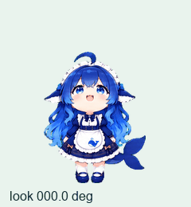

# Codex 大肥鱼 · 女仆装

一套用于 Codex / ChatGPT Pets 的蓝发鲸鱼娘动画素材。以 [白饭鱼 baifanyu](https://github.com/LIN428924379/baifanyu) 的女仆装形象为参考制作，保留蓝白女仆装、鱼鳍耳朵和鲸鱼尾巴。


本仓库提供动画精灵图、预览与辅助脚本，不包含独立的 Windows 桌宠运行程序。

## 内容

- 9 种动作：待机、左右移动、招手、跳跃、失落、等待输入、工作思考、检查。
- 16 个顺时针观察方向。
- 透明 PNG 精灵图：1536 × 2288，单格 192 × 208，8 列 × 11 行。
- 73 个有效帧；空闲格保持透明。
- 所有状态对齐人物比例，待机头顶留白；保留原版跳跃动作，脚底腾空约 31 像素。



## 获取和使用

下载 [`assets/spritesheet.png`](assets/spritesheet.png)。在支持自定义 v2 动画表的 Pets 环境中，交给 Pets 插件创建或更新宠物即可。导入能力取决于使用的客户端及版本。

也可以直接查看 [`previews/all-states.gif`](previews/all-states.gif) 和 [`previews/contact.png`](previews/contact.png)。

## 检查素材格式

需要 Python 3.10 或更新版本：

```bash
python -m pip install -r requirements.txt
python tools/check_sheet.py assets/spritesheet.png
python tools/render_previews.py assets/spritesheet.png --output-dir build/previews
```

`check_sheet.py` 检查尺寸、透明通道、必需帧、空闲格与文件哈希；它不检查人物身份、动作自然程度或客户端兼容性。布局细节见 [FORMAT.md](docs/FORMAT.md)。

## 来源、制作和许可

角色参考来自 [LIN428924379/baifanyu](https://github.com/LIN428924379/baifanyu) 的女仆装皮肤。动画由 AI 图像工具基于该形象生成，再进行提取、去背景、注册对齐和校验。留白调整使用统一缩放及基线对齐，跳跃保留初版动作。

**代码与美术采用不同的许可范围：**

- 本仓库新编写的工具脚本和文档采用 [MIT](LICENSE)。
- 角色、精灵图与图像/视频预览不在上述 MIT 许可范围内，保留上游注明的个人非商业使用限制；详见 [ARTWORK_NOTICE.md](ARTWORK_NOTICE.md)。
- 本项目不是 DeepSeek 或 OpenAI 官方作品，也不表示获得其背书。

因此，本仓库公开提供制作工具和非商业交流用素材，不表示整套角色美术取得了 MIT、Apache 或其他自由开源许可。完整来源见 [CREDITS.md](CREDITS.md)。
